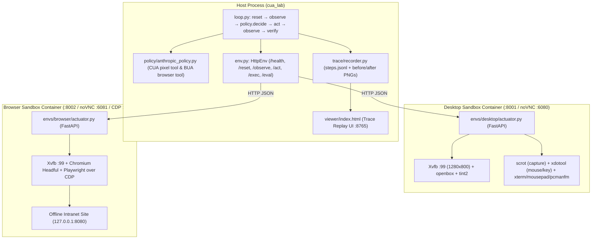

# cua-lab

A minimal, inspectable experimental harness for studying **Computer-Use Agents (CUA)** and **Browser-Use Agents (BUA)** side by side.

`cua-lab` drives two isolated Docker sandboxes—a Linux X11 desktop and a headful Chromium browser—through a single 60-line agent loop ([`cua_lab/loop.py`](cua_lab/loop.py)). Every observation, DOM element list, model tool call, action execution result, and before/after screenshot is recorded to disk and can be inspected frame by frame in a standalone replay viewer.

---

## Architecture



Both containers expose the exact same HTTP interface. The agent loop does not know whether it is driving an X11 desktop or a web browser, allowing direct controlled ablations across observation and action spaces.

---

## CUA (`pixel`) vs. BUA (`dom`) at the Protocol Level

Running the same browser task under `--obs pixel` and `--obs dom` isolates the difference between coordinate-based computer use and structure-based browser use:

| Dimension | `pixel` Mode (CUA) | `dom` Mode (BUA) |
|---|---|---|
| **Observation input** | Raw PNG screenshot (`1280×800` or viewport size) | PNG screenshot + numbered list of visible interactive DOM elements (`[id] tag "label" @ (x, y)`) |
| **Tool schema** | Anthropic `computer` tool (`computer_toolset_20260801` or `computer_20250124`) | Custom `browser` function tool (`goto`, `click`, `type`, `scroll`, `key`, `wait`, `finish`) |
| **Target addressing** | Pixel coordinates `(x, y)` in screenshot space | Per-step `element_id` mapped to `[data-cua-id="..."]` via Playwright locators |
| **Text entry** | Requires prior click to focus the target input field before `type` | `type_element(element_id, text, submit)` focuses and fills the target element directly |
| **Typical failure modes** | Coordinate offset errors, missed focus before typing, UI animation timing | Stale `element_id` across DOM re-renders, unindexed custom widgets, off-viewport elements |

---

## Quickstart

### 1. Prerequisites
* **Docker Desktop** (or Docker Engine with Compose v2)
* **Python 3.10+** and [**uv**](https://docs.astral.sh/uv/)

### 2. Setup and Smoke Test

```bash
cp .env.example .env          # Set ANTHROPIC_API_KEY (and optional gateway variables)
uv sync
make up                       # Build and start both sandbox containers
make doctor                   # Verify Python env, API credentials, and container health

# Verify both sandboxes and trace recording without calling an LLM API
make smoke-desktop
make smoke-browser
```

### 3. Watch Live & Replay Traces

While a task is running, you can watch the sandboxes live in your browser via noVNC:
* **Desktop live view**: [http://localhost:6080/vnc.html?autoconnect=1&resize=scale](http://localhost:6080/vnc.html?autoconnect=1&resize=scale)
* **Browser live view**: [http://localhost:6081/vnc.html?autoconnect=1&resize=scale](http://localhost:6081/vnc.html?autoconnect=1&resize=scale)

Run a task and open the trace replay UI:

```bash
# Run a desktop CUA task
uv run cua-lab run --task tasks/desktop/d1_create_file.yaml

# Compare BUA (dom) vs CUA (pixel) on the same browser task
uv run cua-lab run --task tasks/browser/b1_form.yaml --obs dom
uv run cua-lab run --task tasks/browser/b1_form.yaml --obs pixel

# Start the trace viewer at http://127.0.0.1:8765/index.html
uv run cua-lab view
```

### Trace Viewer Controls (`http://127.0.0.1:8765/index.html`)
* `←` / `→`: Step backward / forward through the trajectory.
* `b`: Toggle between the **before** and **after** screenshot of the current step.
* `d`: Toggle the **DOM bounding-box overlay** (`#id` frames for all extracted interactive elements on the `before` screenshot, with the targeted element highlighted in yellow).
* Numbered yellow pins mark the exact `(x, y)` click/type location on the screenshot for both `pixel` and `dom` actions.

---

## CLI Reference

```text
uv run cua-lab <command> [options]
```

| Command | Description | Key Options |
|---|---|---|
| `cua-lab run` | Run a single task YAML inside its target sandbox | `--task <path>`, `--obs {pixel,dom}`, `--policy {api,script}`, `--model <id>`, `--tool <type>`, `--max-steps <n>`, `--no-reset` |
| `cua-lab view` | Serve the local trace replay UI | `--port 8765`, `--traces traces`, `--no-open` |
| `cua-lab tasks` | List all available task definitions | `--root tasks` |
| `cua-lab doctor` | Check environment variables, sandbox health, and trace directory permissions | — |

---

## Built-in Task Suite

Each task in [`tasks/`](tasks/) is a single YAML file specifying `id`, `env`, default `obs`, natural-language `instruction`, `max_steps`, and a deterministic post-run `verifier` (`shell` command for desktop, `js` expression for browser).

| Task ID | Sandbox | Default `obs` | Description | Verifier |
|---|---|---|---|---|
| [`d0_smoke`](tasks/desktop/d0_smoke.yaml) | `desktop` | `pixel` | Scripted smoke test (screenshot + finish) | `shell`: `true` |
| [`d1_create_file`](tasks/desktop/d1_create_file.yaml) | `desktop` | `pixel` | Open `xterm` and write `hello-cua-lab` to `/root/Desktop/hello.txt` | `shell`: file exists with exact line |
| [`d2_editor_save`](tasks/desktop/d2_editor_save.yaml) | `desktop` | `pixel` | Open `Mousepad` GUI editor, type a sentence, and save to `/root/Desktop/note.txt` | `shell`: `grep` target string in file |
| [`d3_count_files`](tasks/desktop/d3_count_files.yaml) | `desktop` | `pixel` | Count `.txt` files in `/root/data` and write the count to `/root/Desktop/count.txt` | `shell`: file contents equal `3` |
| [`b0_smoke`](tasks/browser/b0_smoke.yaml) | `browser` | `dom` | Scripted smoke test (`goto /index.html` + finish) | `js`: `location.pathname === '/index.html'` |
| [`b1_form`](tasks/browser/b1_form.yaml) | `browser` | `dom` | Navigate to Contact page, fill Name/Email/Message, and submit | `js`: on `/success.html` with `name=John` |
| [`b2_find_person`](tasks/browser/b2_find_person.yaml) | `browser` | `dom` | Find the employee with salary `95000` on the Team page and open their profile | `js`: `location.pathname === '/team/p14.html'` |
| [`b3_scroll_last`](tasks/browser/b3_scroll_last.yaml) | `browser` | `dom` | Scroll to the bottom of the 30-row Team table and open the last person's profile | `js`: `location.pathname === '/team/p30.html'` |

---

## Actuator HTTP Interface

Both [`envs/desktop/actuator.py`](envs/desktop/actuator.py) (`:8001`) and [`envs/browser/actuator.py`](envs/browser/actuator.py) (`:8002`) implement the same 6 endpoints:

* `GET /health` — Returns container readiness, screen dimensions (`width`, `height`), and active display/URL.
* `POST /reset` — Restores the sandbox to a clean initial state before a run:
  * **Desktop**: Terminates open user apps (`xterm`, `mousepad`, `pcmanfm`), wipes `/root/Desktop`, `/root/data`, `/root/archive`, restores seed files from `/opt/seed`, and centers the mouse cursor.
  * **Browser**: Closes extra tabs, navigates to `http://127.0.0.1:8080/`, resets scroll position to `(0, 0)`, and clears `localStorage` / `sessionStorage`.
* `POST /observe` (`{"mode": "pixel" | "dom"}`) — Waits for UI frames to settle, then returns base64 PNG `screenshot`, `width`, `height`, `changed` flag, `cursor` position (desktop), and interactive `elements` list (browser `dom` mode).
* `POST /act` (`{"action": {...}}`) — Dispatches a normalized action (`click`, `double_click`, `triple_click`, `right_click`, `middle_click`, `move`, `drag`, `scroll`, `type`, `key`, `hold_key`, `wait`, `goto`, `click_element`, `type_element`, `screenshot`, `cursor_position`, `finish`) and returns `{"ok": true}` or `{"ok": false, "error": "..."}`.
* `POST /exec` (`{"cmd": "..."}`) — Executes a shell command inside the container for task verification.
* `POST /eval` (`{"expr": "..."}`) — Evaluates a JavaScript expression in the active Chromium page for browser task verification.

---

## Model & Gateway Configuration

`.env` in the repository root is loaded automatically by the CLI (existing shell environment variables take precedence).

### Direct Anthropic API

```bash
ANTHROPIC_API_KEY=sk-ant-...
CUA_MODEL=claude-sonnet-4-20250514
CUA_TOOL=computer_toolset_20260801   # or computer_20250124
```

### Anthropic-Compatible Gateways (LiteLLM / OpenRouter)

Proxy gateways often modify typed Anthropic computer tools in transit:
1. `computer_toolset_20260801` may be flattened by LiteLLM into an unnamed tool with empty input (`litellm_unnamed_tool_0`), which [`AnthropicPolicy`](cua_lab/policy/anthropic_policy.py) catches and surfaces as a `PolicyError`.
2. `computer_20250124` with `anthropic-beta: computer-use-2025-01-24` passes through gateways intact, though gateways may serialize the action name under `type` instead of `action` and text payloads under `value` or `key` instead of `text`. [`_normalize()`](cua_lab/policy/anthropic_policy.py) normalizes all of these variants.
3. Custom function tools (`BROWSER_TOOL` in `dom` mode) pass through unchanged on all gateways.

Recommended `.env` for a LiteLLM / OpenRouter gateway:

```bash
ANTHROPIC_BASE_URL=https://your-gateway.example.com
ANTHROPIC_API_KEY=sk-...
CUA_MODEL=openrouter/anthropic/claude-sonnet-4.6
CUA_TOOL=computer_20250124
CUA_ANTHROPIC_BETA=computer-use-2025-01-24
```

---

## Implementation Mechanics & Experimental Knobs

| Mechanism | Location | Behavior |
|---|---|---|
| **Frame-diffing UI settle** | `settle()` in [`envs/*/actuator.py`](envs/desktop/actuator.py) | Polls screenshots every `120–150 ms` after an action and computes mean pixel diff (`ImageChops.difference`) until 2 consecutive frames differ by `< 0.4` (up to `3–4 s` timeout). |
| **Visual history pruning** | `_strip_old_images()` in [`anthropic_policy.py`](cua_lab/policy/anthropic_policy.py) | Replaces screenshots from earlier turns with `"[previous screenshot omitted]"` to avoid ~1.5k image tokens compounding per step. Set `CUA_KEEP_IMAGES=1` to retain full visual history. |
| **Execution feedback** | `_tool_results()` in [`anthropic_policy.py`](cua_lab/policy/anthropic_policy.py) | Surfaces actuator errors (`ok: false`), cursor coordinates (`cursor_position`), and unchanged-screen notices (`changed: false`) back to the model in `tool_result`. |
| **DOM element extraction** | `DOM_JS` in [`envs/browser/actuator.py`](envs/browser/actuator.py) | Queries interactive elements intersecting the current viewport, resolves labels (`innerText`, `value`, `aria-label`, `<label>` associations, `placeholder`, `name`, `id`), assigns `[data-cua-id]`, and records center `(x, y)` plus bounding box `(left, top, w, h)`. |
| **Sandbox state reset** | `/reset` in [`envs/*/actuator.py`](envs/desktop/actuator.py) | Automatically invoked before every `cua-lab run` so tasks cannot pass on leftover files, open windows, or previous browser URLs. Pass `--no-reset` to preserve state across runs. |

---

## Repository Layout

```text
cua-lab/
├── cua_lab/
│   ├── cli.py                   # CLI entrypoints: run, view, tasks, doctor
│   ├── loop.py                  # Environment-agnostic agent loop (~60 lines)
│   ├── env.py                   # HttpEnv client for container actuators
│   ├── types.py                 # Action, Observation, Decision, Task dataclasses
│   ├── tasks.py                 # YAML task loader
│   ├── verify.py                # Post-trajectory shell & JS verifiers
│   ├── policy/
│   │   ├── base.py              # Policy protocol & PolicyError
│   │   ├── anthropic_policy.py  # CUA (pixel) and BUA (dom) policy adapters
│   │   └── scripted.py          # Deterministic action replay policy
│   ├── trace/
│   │   ├── recorder.py          # Writes meta.json, steps.jsonl, result.json, PNGs
│   │   └── server.py            # Local HTTP server for the trace viewer
│   └── viewer/
│       └── index.html           # Single-file trace replay UI with DOM overlay
├── envs/
│   ├── desktop/                 # Debian Bookworm + Xvfb + openbox + tint2 + xdotool + noVNC
│   └── browser/                 # Debian Bookworm + Chromium + Playwright/CDP + static intranet
├── tasks/
│   ├── desktop/                 # Desktop task YAMLs (d0..d3)
│   └── browser/                 # Browser task YAMLs (b0..b3)
├── docker-compose.yml           # Builds and runs desktop (:8001/:6080) & browser (:8002/:6081)
├── Makefile                     # Shortcuts for up, down, doctor, smoke tests, and sample runs
└── pyproject.toml               # Package metadata and dependencies
```
