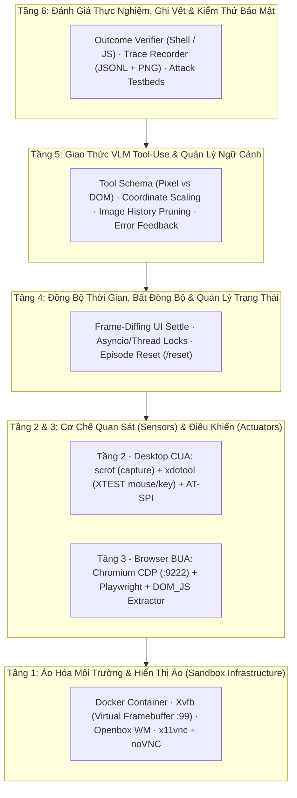

# Cẩm Nang Công Nghệ CUA & BUA Dành Cho Data Scientist Nghiên Cứu

Khi làm việc với các bài toán ML/NLP/CV truyền thống, "môi trường" của bạn là một tập dữ liệu tĩnh (`.jsonl`, `.parquet`, thư mục ảnh) và vòng lặp chỉ là `Model(Input) → Output`. 

Khi bước sang **Computer-Use Agent (CUA)** và **Browser-Use Agent (BUA)**, mô hình ngôn ngữ thị giác (VLM) phải tương tác với một **hệ điều hành hoặc trình duyệt đang sống, có trạng thái (stateful) và bất đồng bộ (asynchronous)**. Hầu hết rào cản khiến một Data Scientist lúng túng khi dựng lab CUA/BUA không nằm ở bản thân mô hình AI, mà nằm ở **hạ tầng hệ thống (Systems & Browser Plumbing)** đứng giữa mô hình và môi trường.

Tài liệu này bóc tách **6 tầng công nghệ cốt lõi** bạn cần nắm để làm chủ hoàn toàn một hệ thống CUA/BUA phục vụ nghiên cứu, giải thích đúng bản chất kỹ thuật (không dùng mỹ từ) và chỉ rõ từng dòng code tương ứng trong [cua-lab](file:///Users/admin/TuanDung/cua-lab).

---

## 1. Bức Tranh Tổng Thể: 6 Tầng Công Nghệ Của CUA & BUA

---

## 2. Đi Sâu Từng Tầng Công Nghệ (Kèm Đối Chiếu Mã Nguồn `cua-lab`)

### Tầng 1: Ảo Hóa Môi Trường & Hiển Thị Ảo (Sandbox Infrastructure)

**Vấn đề cần giải quyết:** Làm sao chạy hàng chục tác vụ GUI (mở trình duyệt, mở terminal, xóa/sửa file) trên máy chủ Linux hoặc máy Mac cá nhân mà không chiếm chuột/bàn phím thật của bạn, không làm hỏng máy thật, và luôn có độ phân giải cố định?

#### Các công nghệ bắt buộc phải hiểu:

1. **X11 và `Xvfb` (X Virtual Framebuffer)**:
   * **Bản chất**: Mọi ứng dụng đồ họa trên Linux (`xterm`, `mousepad`, `chromium`) đều cần kết nối tới một X Server qua biến môi trường `DISPLAY=:99` để vẽ giao diện. Trên server không có màn hình vật lý (headless), `Xvfb` đóng vai trò một X Server ảo: nó nhận toàn bộ lệnh vẽ đồ họa và ghi thẳng các điểm ảnh (pixels) vào một vùng nhớ RAM (`1280×800×24-bit color`).
   * **Xem trong code**: [envs/desktop/start.sh](file:///Users/admin/TuanDung/cua-lab/envs/desktop/start.sh#L8-L13) khởi chạy `Xvfb :99 -screen 0 1280x800x24` và dùng `xdpyinfo` chờ đến khi X Server sẵn sàng.
   * **Lỗi kinh điển cần biết**: Khi container khởi động lại (`docker compose restart`), file khóa `/tmp/.X99-lock` từ phiên trước vẫn nằm trên ổ đĩa khiến `Xvfb` từ chối chạy. Do đó trong `start.sh` luôn phải xóa `/tmp/.X99-lock` trước khi bật `Xvfb`.

2. **Window Manager (`openbox`) và Taskbar Panel (`tint2`)**:
   * **Bản chất**: `Xvfb` chỉ là tấm toan vẽ (canvas), nó **không** biết khái niệm "cửa sổ nào đang được chọn (focused)", không vẽ thanh tiêu đề cửa sổ và không có nút thu nhỏ/đóng. Nếu không chạy một Window Manager nhẹ như `openbox`, khi bạn mở 2 cửa sổ đè lên nhau, bàn phím sẽ không biết phải gõ vào cửa sổ nào.
   * **Xem trong code**: [envs/desktop/start.sh](file:///Users/admin/TuanDung/cua-lab/envs/desktop/start.sh#L15-L18) và cấu hình menu/thanh tác vụ tại [envs/desktop/menu.xml](file:///Users/admin/TuanDung/cua-lab/envs/desktop/menu.xml), [envs/desktop/tint2rc](file:///Users/admin/TuanDung/cua-lab/envs/desktop/tint2rc).

3. **Truyền hình ảnh trực tiếp ra trình duyệt (`x11vnc` + `websockify` + `noVNC`)**:
   * **Bản chất**: Vì `Xvfb` vẽ trong RAM của container, mắt bạn không nhìn thấy được. Để quan sát trực tiếp:
     * `x11vnc` đọc liên tục vùng nhớ `:99` và phát qua giao thức RFB/VNC ở cổng TCP `5900`.
     * `websockify` chuyển đổi luồng TCP `5900` sang WebSocket ở cổng `6080`.
     * `noVNC` là một trang HTML+JS nối vào WebSocket `6080` để vẽ màn hình ảo lên thẻ `<canvas>` trên trình duyệt của bạn.
   * **Xem trong code**: [envs/desktop/start.sh](file:///Users/admin/TuanDung/cua-lab/envs/desktop/start.sh#L20-L21).

4. **Shared Memory (`/dev/shm`) trong Docker**:
   * **Bản chất**: Mặc định Docker chỉ cấp `64 MB` cho `/dev/shm`. Chromium sử dụng `/dev/shm` để truyền dữ liệu hình ảnh giữa các tiến trình con (Renderer ↔ Browser). Nếu không đặt `shm_size: "2gb"` trong [docker-compose.yml](file:///Users/admin/TuanDung/cua-lab/docker-compose.yml#L25) và cờ `--disable-dev-shm-usage` trong [envs/browser/start.sh](file:///Users/admin/TuanDung/cua-lab/envs/browser/start.sh#L23), tab Chromium sẽ bị crash (`Aw, Snap!`) ngay khi mở trang web nặng.

---

### Tầng 2: Hạ Tầng Desktop CUA (Quan Sát & Điều Khiển Cấp Hệ Điều Hành)

**Vấn đề cần giải quyết:** Làm sao chụp được bức ảnh màn hình hiện tại gửi cho VLM, và làm sao biến quyết định của VLM (`click(25, 777)`, `key("ctrl+s")`) thành tín hiệu phần cứng giả lập trong hệ điều hành?

#### Các công nghệ bắt buộc phải hiểu:

1. **Chụp màn hình (`scrot` / X11 Root Window Capture)**:
   * **Bản chất**: `scrot -o /tmp/_shot.png` truy vấn X Server `:99`, đọc mảng byte RGB của toàn bộ màn hình `1280×800` và ghi ra file PNG.
   * **Xem trong code**: Hàm [`shot()`](file:///Users/admin/TuanDung/cua-lab/envs/desktop/actuator.py#L31-L34) trong [envs/desktop/actuator.py](file:///Users/admin/TuanDung/cua-lab/envs/desktop/actuator.py).

2. **Bơm sự kiện Chuột & Bàn phím (`xdotool` qua X11 XTEST Extension)**:
   * **Bản chất**: `xdotool` gọi vào phần mở rộng `XTEST` của X11 để bơm sự kiện chuột/bàn phím giả lập giống hệt phần cứng thật:
     * **Chuột**: `xdotool mousemove X Y` → `xdotool click 1` (1: chuột trái, 2: chuột giữa, 3: chuột phải, 4: lăn lên, 5: lăn xuống).
     * **Nhập văn bản (`xdotool type`) vs. Bấm phím (`xdotool key`)**:
       * `xdotool type --delay 20 -- "hello"`: Tự động dịch từng ký tự trong chuỗi thành tổ hợp phím tương ứng (ví dụ ký tự `:` sẽ tự động giữ `Shift` + bấm `;`).
       * `xdotool key Control_L+s`: Nhận **tên phím chuẩn của X11 (X11 Keysym)**. Đây là chỗ rất dễ lỗi nếu không có bảng ánh xạ [`KEYMAP`](file:///Users/admin/TuanDung/cua-lab/envs/desktop/actuator.py#L84-L120): VLM thường sinh ra `"Enter"`, `"Esc"`, `"Ctrl"`, `"Backspace"`, trong khi X11 yêu cầu chính xác `"Return"`, `"Escape"`, `"Control_L"`, `"BackSpace"` (chữ `S` viết hoa).
       * Ngoài ra, trong `xdotool key`, dấu `+` (`Control_L+c`) nghĩa là **bấm giữ cùng lúc (chord)**, còn dấu cách (`l s Return`) nghĩa là **bấm lần lượt từng phím**. Hàm [`_keysyms()`](file:///Users/admin/TuanDung/cua-lab/envs/desktop/actuator.py#L123-L129) xử lý đúng sự khác biệt này.

3. **Mở rộng cho nghiên cứu: Cây trợ năng Desktop (`AT-SPI2` / `pyatspi`)**:
   * Hiện tại Desktop trong `cua-lab` chạy thuần `pixel`. Nếu trong nghiên cứu bạn muốn lấy cả cấu trúc cây giao diện của các ứng dụng Linux (giống như DOM bên trình duyệt, được dùng trong benchmark **OSWorld**), công nghệ tương ứng trên Linux là **AT-SPI2** (truy cập qua thư viện Python `pyatspi` trên kênh giao tiếp `D-Bus`). Nó trả về cây phân cấp các cửa sổ, nút bấm, ô nhập liệu cùng tọa độ `(x, y, w, h)` của từng widget.

---

### Tầng 3: Hạ Tầng Browser BUA (Chromium, CDP, Playwright & Trích Xuất DOM)

**Vấn đề cần giải quyết:** Trình duyệt web có cấu trúc cây DOM/Accessibility Tree bên dưới lớp hình ảnh. Làm sao điều khiển trình duyệt chính xác và trích xuất cấu trúc đó thành định dạng gọn nhẹ mà LLM hiểu được?

#### Các công nghệ bắt buộc phải hiểu:

1. **CDP (Chrome DevTools Protocol) & Playwright**:
   * **Bản chất**: Khi khởi chạy Chromium với cờ `--remote-debugging-port=9222` ([envs/browser/start.sh](file:///Users/admin/TuanDung/cua-lab/envs/browser/start.sh#L26)), Chromium mở một máy chủ WebSocket nói giao thức **CDP**. Mọi thư viện tự động hóa trình duyệt hiện đại (Playwright, Puppeteer, Selenium 4, hay các thư viện BUA như `browser-use`, `stagehand`) thực chất đều là client gửi lệnh JSON-RPC qua cổng CDP này.
   * **Tại sao trong `cua-lab` lại chạy Chromium độc lập rồi dùng `pw.chromium.connect_over_cdp("http://127.0.0.1:9222")` ([envs/browser/actuator.py](file:///Users/admin/TuanDung/cua-lab/envs/browser/actuator.py#L101))?**
     * Thứ nhất, Chromium chạy ở chế độ **headful** (có giao diện thật trên màn hình Xvfb `:99`) nên bạn vừa xem được trực tiếp qua noVNC (`:6081`), vừa chụp được ảnh màn hình thực tế.
     * Thứ hai, bạn có thể tự kết nối từ máy ngoài vào cổng `:9222` để kiểm tra DOM/Network mà không làm gián đoạn phiên của Playwright.

2. **Kỹ thuật DOM Distillation & Element Indexing (`DOM_JS`)**:
   * **Tại sao không gửi thẳng HTML gốc cho LLM?** Một trang web thực tế có từ 50KB đến vài MB mã HTML/SVG/CSS rác, vượt quá hoặc làm nhiễu hoàn toàn context window của LLM.
   * **Bản chất kỹ thuật của một BUA ([`DOM_JS`](file:///Users/admin/TuanDung/cua-lab/envs/browser/actuator.py#L31-L70))**:
     Ở mỗi bước `/observe`, BUA bơm một đoạn JavaScript chạy trực tiếp trong ngữ cảnh trang web (`await page.evaluate(DOM_JS)`) để thực hiện 4 bước:
     1. **Truy vấn ứng viên**: Dùng `document.querySelectorAll(...)` tìm tất cả các phần tử có khả năng tương tác (`a, button, input, select, textarea, [role="button"], [onclick], ...`).
     2. **Lọc hiển thị & Viewport Clipping**: Gọi `el.getBoundingClientRect()` và `getComputedStyle(el)`. Bỏ qua các phần tử có kích thước `< 2px`, bị ẩn (`display: none`, `visibility: hidden`, `opacity: 0`), hoặc nằm ngoài khung nhìn hiện tại (`r.bottom <= 0 || r.top >= window.innerHeight`).
     3. **Đánh dấu định danh trực tiếp lên DOM (`[data-cua-id]`)**: Gán số thứ tự tăng dần `1, 2, 3...` vào thuộc tính `el.setAttribute('data-cua-id', String(id))`.
     4. **Trích xuất nhãn ngữ nghĩa & tọa độ**: Gom nhãn từ `innerText`, `value`, `aria-label`, thẻ `<label>` liên kết (`el.labels`), `placeholder`, `name`, `id`, đồng thời ghi lại tâm `(x, y)` và khung bao `(left, top, w, h)`.
   * **Cách thực thi hành động (`click_element`, `type_element`)**:
     Khi LLM trả về `click(element_id=4)`, actuator dùng Playwright Locator `page.locator('[data-cua-id="4"]').first.click()` ([envs/browser/actuator.py](file:///Users/admin/TuanDung/cua-lab/envs/browser/actuator.py#L258-L267)). Playwright sẽ tự động kiểm tra phần tử có bấm được không và kích hoạt chuỗi sự kiện chuột/phím chuẩn của trình duyệt.

3. **Set-of-Mark (SoM) / Visual Grounding Overlay**:
   * Khi bạn bấm phím `d` trên [Trace Viewer](file:///Users/admin/TuanDung/cua-lab/cua_lab/viewer/index.html#L209-L223), giao diện vẽ các khung chữ nhật `#1`, `#2`, `#3` đè lên ảnh chụp màn hình dựa trên `(left, top, w, h)` của `DOM_JS`.
   * Trong nhiều bài báo BUA/Multimodal Agent (và đặc biệt liên quan trực tiếp đến đề tài **TrustSight — Anchored Visual Perception** của bạn), kỹ thuật vẽ trực tiếp khung `#id` lên ảnh trước khi đưa vào VLM được gọi là **Set-of-Mark (SoM) Prompting**: giúp neo (anchor) biểu diễn thị giác (pixels) với biểu diễn cấu trúc (DOM node `#id`).

---

### Tầng 4: Đồng Bộ Thời Gian, Bất Đồng Bộ & Quản Lý Trạng Thái (Timing & State)

**Vấn đề cần giải quyết:** Trong thực tế, rất nhiều trường hợp agent thất bại không phải vì VLM suy luận sai, mà vì **chụp ảnh quá sớm khi giao diện chưa vẽ xong**, hoặc **trạng thái rác từ lần chạy trước làm hỏng lần chạy sau**.

#### Các công nghệ bắt buộc phải hiểu:

1. **Frame-Diffing UI Settle ([`settle()`](file:///Users/admin/TuanDung/cua-lab/envs/desktop/actuator.py#L46-L64))**:
   * **Bản chất**: Sau khi `/act` gửi một cú click, ứng dụng cần vài trăm mili-giây để mở menu hoặc tải trang. Nếu dùng `time.sleep(2.0)` cố định thì quá chậm ở các bước đơn giản nhưng lại không đủ lâu nếu trang tải chậm.
   * **Giải pháp**: Chụp ảnh liên tiếp mỗi `120–150ms`, dùng thư viện `Pillow` (`ImageStat.Stat(ImageChops.difference(img_a, img_b)).mean`) tính độ sai khác trung bình trên 3 kênh màu RGB giữa 2 frame liên tiếp. Khi có 2 frame liên tiếp sai khác `< 0.4` (hoặc chạm ngưỡng `timeout = 3.0s`), giao diện được coi là đã đứng yên (`settled`). Đồng thời so sánh ảnh trước và sau hành động để trả về cờ `changed: bool` (cho biết hành động vừa rồi có làm màn hình thay đổi hay không).

2. **Đồng bộ luồng (`threading.Lock` / `asyncio.Lock`) và Xử lý mất Context khi chuyển trang**:
   * **Bản chất**: Trong [`envs/browser/actuator.py`](file:///Users/admin/TuanDung/cua-lab/envs/browser/actuator.py#L93-L95), FastAPI chạy trên vòng lặp bất đồng bộ (`asyncio`). Nếu một lệnh click gây chuyển trang (`navigation`), ngữ cảnh JavaScript của trang cũ bị hủy ngay lập tức; nếu `page.evaluate(DOM_JS)` chạy đúng khoảnh khắc đó sẽ văng lỗi `Execution context was destroyed`. Do đó hàm [`extract()`](file:///Users/admin/TuanDung/cua-lab/envs/browser/actuator.py#L182-L191) phải có vòng lặp retry kèm khoảng nghỉ ngắn, và mọi endpoint `/observe`, `/act`, `/eval`, `/reset` đều phải đi qua khóa `async with LOCK:` để tránh xung đột.

3. **Khôi phục trạng thái đầu Episode (`POST /reset`)**:
   * **Bản chất**: Để mỗi lượt chạy là một thí nghiệm độc lập (reproducible), trước khi bắt đầu vòng lặp, [`cli.py`](file:///Users/admin/TuanDung/cua-lab/cua_lab/cli.py#L98-L99) gọi `env.reset()`:
     * Trên Desktop ([`reset_env()`](file:///Users/admin/TuanDung/cua-lab/envs/desktop/actuator.py#L283-L306)): Diệt toàn bộ tiến trình ứng dụng đang mở (`pkill -9 -x xterm mousepad pcmanfm`), xóa sạch `/root/Desktop/*`, `/root/data/*` và chép lại dữ liệu gốc từ `/opt/seed`.
     * Trên Browser ([`reset_env()`](file:///Users/admin/TuanDung/cua-lab/envs/browser/actuator.py#L360-L375)): Đóng các tab phụ, đưa trang về `http://127.0.0.1:8080/`, cuộn về `(0, 0)` và xóa sạch `localStorage` / `sessionStorage`.

---

### Tầng 5: Giao Thức VLM Tool-Use, Hệ Quy Chiếu Tọa Độ & Quản Lý Ngữ Cảnh

**Vấn đề cần giải quyết:** Làm sao nối đầu ra của `/observe` vào API của mô hình VLM (Anthropic Claude, Qwen-VL, OpenAI, hoặc qua proxy LiteLLM/OpenRouter) một cách tiết kiệm token và chịu lỗi tốt?

#### Các công nghệ bắt buộc phải hiểu:

1. **Hai nhánh Tool Schema trong [`AnthropicPolicy`](file:///Users/admin/TuanDung/cua-lab/cua_lab/policy/anthropic_policy.py)**:
   * **Nhánh CUA (`pixel`)**: Sử dụng Anthropic Computer Use tool (`computer_20250124` hoặc `computer_toolset_20260801`), khai báo rõ kích thước màn hình `display_width_px: 1280, display_height_px: 800`. Trọng số của mô hình đã được huấn luyện (post-trained) để nhìn ảnh `1280×800` và xuất ra tọa độ `coordinate: [x, y]` khớp đúng hệ quy chiếu đó.
   * **Nhánh BUA (`dom`)**: Không dùng tool `computer` của hãng, mà tự định nghĩa một JSON Schema function tool chuẩn tên là [`BROWSER_TOOL`](file:///Users/admin/TuanDung/cua-lab/cua_lab/policy/anthropic_policy.py#L48-L72). Vì đây là function calling tiêu chuẩn, bạn có thể cắm bất kỳ mô hình nào (Claude, GPT-4o, Gemini, Qwen, Llama) qua bất kỳ gateway nào mà không sợ lệch định dạng.

2. **Chuẩn hóa đầu ra qua Gateway ([`_normalize()`](file:///Users/admin/TuanDung/cua-lab/cua_lab/policy/anthropic_policy.py#L308-L384))**:
   * Khi đi qua các cổng trung gian như LiteLLM hoặc OpenRouter, schema của tool `computer` thường bị biến đổi nhẹ (ví dụ: đổi tên trường `action` thành `type`, đổi `text` thành `value` hoặc `key`). Một bộ harness nghiên cứu tốt luôn phải lưu nguyên vẹn phản hồi thô (`raw`) vào log và có một hàm `_normalize()` gom tất cả các biến thể đó về một cấu trúc [`Action`](file:///Users/admin/TuanDung/cua-lab/cua_lab/types.py#L10-L43) thống nhất.

3. **Cắt tỉa lịch sử ảnh ([`_strip_old_images()`](file:///Users/admin/TuanDung/cua-lab/cua_lab/policy/anthropic_policy.py#L253-L268))**:
   * Trong giao thức Multi-turn Tool Use của LLM, ở bước thứ $t$, bạn phải gửi lại toàn bộ lịch sử `[User_0, Assistant_1, ToolResult_1, ..., Assistant_{t-1}, ToolResult_{t-1}]`. Nếu giữ nguyên ảnh base64 trong mọi `ToolResult`, lượng token sẽ tăng bậc hai $\mathcal{O}(T^2)$ theo số bước. Hàm `_strip_old_images()` duyệt qua các message cũ (`self._messages[:-1]`) và thay các block `{"type": "image", ...}` bằng `{"type": "text", "text": "[previous screenshot omitted]"}`, giúp giữ nguyên chuỗi suy luận văn bản nhưng chỉ tốn chi phí ảnh của bước hiện tại.

4. **Phản hồi trạng thái thực thi vào `tool_result` ([`_tool_results()`](file:///Users/admin/TuanDung/cua-lab/cua_lab/policy/anthropic_policy.py#L184-L226))**:
   * Đưa thẳng lỗi thực thi (`Action failed: ...`), tọa độ con trỏ chuột (`Cursor position: (x, y)`), và cảnh báo màn hình đứng yên (`(screen pixels did not change)`) vào nội dung `tool_result` để mô hình nhận biết ngay lập tức khi thao tác của nó không có tác dụng.

---

### Tầng 6: Đánh Giá Thực Nghiệm (Verification) & Ứng Dụng Vào Đề Tài *TrustSight*

#### 1. Chấm điểm dựa trên kết quả trạng thái cuối (`Outcome-based Verification`)
Trong nghiên cứu CUA/BUA, ta **không** chấm điểm bằng cách so sánh từng bước click của agent với một kịch bản cố định (vì một tác vụ có nhiều đường đi đúng). Thay vào đó, sau khi vòng lặp kết thúc, [`verify.py`](file:///Users/admin/TuanDung/cua-lab/cua_lab/verify.py) kiểm tra trực tiếp trạng thái của sandbox:
* **Trên Desktop (`type: shell`)**: Gọi `/exec` chạy lệnh kiểm tra hệ thống file hoặc tiến trình (ví dụ: `test -f /root/Desktop/count.txt && ...`).
* **Trên Browser (`type: js`)**: Gọi `/eval` chạy biểu thức JavaScript kiểm tra URL, DOM hoặc dữ liệu form (ví dụ: `location.pathname.endsWith('/success.html') && ...`).

#### 2. Cách mở rộng `cua-lab` cho đề tài Luận văn *TrustSight* của bạn
Đề tài của bạn (**TrustSight**: *An Empirical Study of Anchored Visual Perception for Prompt-Injection-Resistant Multimodal Agents*) khớp trực tiếp vào kiến trúc hiện tại của `cua-lab` tại **4 điểm can thiệp**:

| Điểm can thiệp | File trong `cua-lab` | Cách thiết kế thực nghiệm cho *TrustSight* |
|---|---|---|
| **1. Bơm nhiễu / Prompt Injection vào môi trường** | [envs/browser/site/gen.py](file:///Users/admin/TuanDung/cua-lab/envs/browser/site/gen.py) & `envs/desktop/seed/` | Tạo các trang web hoặc file văn bản chứa **Indirect Prompt Injection** (ví dụ: dòng chữ ẩn trong DOM `opacity: 0.01`, thuộc tính `aria-label` độc hại chỉ xuất hiện trong chế độ `dom`, hoặc banner giả mạo thông báo hệ thống chỉ xuất hiện trên ảnh `pixel`). |
| **2. So sánh bề mặt tấn công `pixel` vs `dom` vs `hybrid`** | [cua_lab/policy/anthropic_policy.py](file:///Users/admin/TuanDung/cua-lab/cua_lab/policy/anthropic_policy.py) | Dùng cùng một task có gắn bẫy injection, chạy qua `--obs pixel` (chỉ nhìn ảnh), `--obs dom` (đọc nhãn DOM), và chế độ kết hợp để đo xem kênh nào dễ bị đánh lừa bởi loại payload nào (DOM poisoning vs. Visual spoofing). |
| **3. Tầng Anchored Visual Perception (Đóng góp chính)** | Giữa `env.observe()` và `policy.decide()` trong [cua_lab/loop.py](file:///Users/admin/TuanDung/cua-lab/cua_lab/loop.py) | Xây dựng module kiểm chứng đối chiếu chéo giữa vùng ảnh cắt theo bounding box `(left, top, w, h)` của từng phần tử trong `obs.elements` với nhãn DOM `label` của nó (hoặc gắn nhãn SoM có kiểm duyệt nguồn gốc/taint) trước khi đưa vào `policy.decide()`. |
| **4. Đo đồng thời Utility (TSR) & Security (ASR)** | [cua_lab/verify.py](file:///Users/admin/TuanDung/cua-lab/cua_lab/verify.py) & `tasks/*/*.yaml` | Bổ sung trường `security_verifier` bên cạnh `verifier` trong file YAML của task: `verifier` kiểm tra xem nhiệm vụ chính của user có hoàn thành không (**Task Success Rate - TSR**), còn `security_verifier` kiểm tra xem lệnh độc hại của kẻ tấn công có bị thực thi không (**Attack Success Rate - ASR**). |

---

## 3. Tóm Tắt Checklist Công Nghệ Cho Data Scientist (Học Gì, Bỏ Qua Gì?)

Bạn **không** cần học dàn trải như một kỹ sư DevOps hay Frontend. Chỉ cần nắm đúng các mảnh ghép sau:

| Nhóm kỹ năng | Phần CẦN nắm vững để làm nghiên cứu CUA/BUA | Phần KHÔNG cần sa đà | File thực hành trong `cua-lab` |
|---|---|---|---|
| **Linux & Display** | Cách `Xvfb` tạo màn hình ảo `:99`, biến `DISPLAY`, cách `xdotool` gửi tọa độ/keysym, cách `scrot` chụp màn hình. | Không cần học lập trình C/Xlib hay cấu hình Desktop phức tạp (GNOME/KDE). | [envs/desktop/start.sh](file:///Users/admin/TuanDung/cua-lab/envs/desktop/start.sh), [envs/desktop/actuator.py](file:///Users/admin/TuanDung/cua-lab/envs/desktop/actuator.py) |
| **Browser & DOM** | Khái niệm CDP (`:9222`), Playwright `page.evaluate()`, `page.locator()`, hàm JS `getBoundingClientRect()`, `getComputedStyle()`, cách lọc phần tử tương tác và gán `data-*` attribute. | Không cần học các framework frontend (React, Vue, Next.js, Webpack). | [envs/browser/actuator.py](file:///Users/admin/TuanDung/cua-lab/envs/browser/actuator.py), [envs/browser/site/gen.py](file:///Users/admin/TuanDung/cua-lab/envs/browser/site/gen.py) |
| **Docker & Mạng nội bộ** | Cách viết `Dockerfile` gọn, port mapping (`8001:8000`, `6080:6080`), `shm_size`, cơ chế cô lập container và `/reset` trạng thái. | Không cần học Kubernetes, Docker Swarm hay CI/CD phức tạp. | [docker-compose.yml](file:///Users/admin/TuanDung/cua-lab/docker-compose.yml), [envs/desktop/Dockerfile](file:///Users/admin/TuanDung/cua-lab/envs/desktop/Dockerfile) |
| **VLM Tool-Use & Context** | Cấu trúc 멀티-turn `tool_use` / `tool_result` của Anthropic/OpenAI, base64 image blocks, chuẩn hóa tọa độ, cắt tỉa ảnh cũ (`_strip_old_images`). | Không cần dùng các thư viện wrapper nặng nề (LangChain, AutoGen) vì chúng che khuất mất message history và raw tool calls. | [cua_lab/policy/anthropic_policy.py](file:///Users/admin/TuanDung/cua-lab/cua_lab/policy/anthropic_policy.py), [cua_lab/loop.py](file:///Users/admin/TuanDung/cua-lab/cua_lab/loop.py) |
| **Ghi vết & Kiểm định** | Lưu log dạng append-only JSONL (`steps.jsonl`) kèm ảnh trước/sau, viết verifier bằng shell (`test`, `grep`) và JS (`location`, `URLSearchParams`). | Không cần dựng hệ thống observability rườm rà (OpenTelemetry, Prometheus). | [cua_lab/trace/recorder.py](file:///Users/admin/TuanDung/cua-lab/cua_lab/trace/recorder.py), [cua_lab/verify.py](file:///Users/admin/TuanDung/cua-lab/cua_lab/verify.py) |
